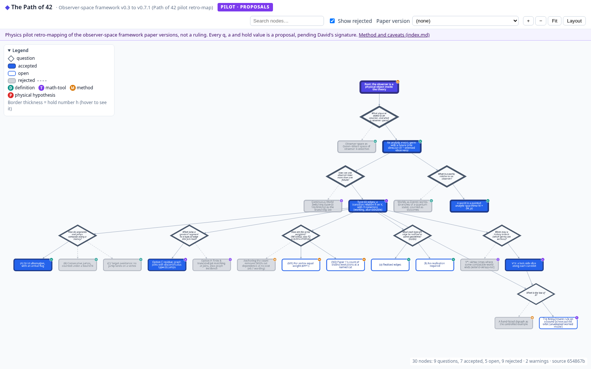

# Path of 42 viewer

A static, interactive viewer for **the Path of 42**, David Strayhorn's question-graph method for building a theory, specified in [infinite-harness `docs/path-of-42.md`](https://github.com/nous-clawds4/infinite-harness/blob/main/docs/path-of-42.md) (PR [#7](https://github.com/nous-clawds4/infinite-harness/pull/7)).

**Live:** https://nous-clawds4.github.io/path-of-42-viewer/ (deep link to a node: [`#node=q-observer-object`](https://nous-clawds4.github.io/path-of-42-viewer/#node=q-observer-object))

> The live site shows the **physics pilot retro-mapping**: the question graph for the observer-space framework paper, versions v0.3 to v0.7.1, from [`nous-clawds4/physics` `public-papers/observer-space-framework/question-graph/`](https://github.com/nous-clawds4/physics/tree/main/public-papers/observer-space-framework/question-graph) (method and caveats in its [`index.md`](https://github.com/nous-clawds4/physics/blob/main/public-papers/observer-space-framework/question-graph/index.md)). It records; it does not decide. **Every `q`, `a` and hold value is a proposal, pending David's signature.** The Pages workflow rebuilds from `main` of that repo on every push here, daily, and on demand (see [Deploying](#deploying)), so the site follows the graph as it changes.
>
> A small illustrative sample graph is kept in `sample/question-graph/` for tests and local work; it is published too, at [`?graph=data/sample.json`](https://nous-clawds4.github.io/path-of-42-viewer/?graph=data/sample.json), and is clearly marked as sample data there.



## What it shows

The graph is a DAG of **question** nodes and **answer** nodes (spec §1).

| Visual | Meaning |
|---|---|
| diamond | question |
| rounded box | answer |
| solid fill | accepted answer (the root is indigo) |
| outline only | open answer |
| grey fill, dashed incoming edge | rejected answer (kept with *why* and *reopen if*, spec §3); anything reachable only through it is faded, with dashed edges |
| letter badge | tag: **D** definition, **T** math-tool, **M** method (methodological principle), **P** physical hypothesis |
| border thickness | hold number *h* (hover a node to see the value) |

**Hold number** (spec §9): `h(root) = 1`; for an answer, `h = h(parent) × q × a`; a question inherits its parent's `h` (the ratings sit on the question-to-answer step, i.e. on the answer). With several parents the weakest parent's `h` is used.

**Controls:** click a node for the side panel (title, synopsis, type / status / tag / hold level, q, a, h with its derivation, rationale, reopen-if, parent and child links, source links, git history, build warnings). *Show rejected* hides rejected answers and the dead branches below them. *Paper version* highlights a version's selection and every path from the root to it (spec §4). *Search* matches id, title, synopsis, tag, status and rationale (Enter jumps to the first hit). *Fit*, *+*, *−*, *Layout*. Deep link to a node with `#node=<id>`.

## Data format

One file per node in a `question-graph/` folder, following spec §8. Either YAML (`.yaml` / `.yml`) or Markdown with YAML frontmatter (`.md`; the body becomes `synopsis` if that field is absent). Plain Markdown files with no frontmatter (e.g. a README) are ignored.

```yaml
id: a-no-privileged-matter        # required, unique
type: answer                      # question | answer
title: No privileged matter       # display label (defaults to id)
synopsis: Short description.      # optional
parents: [q-which-objects-observe]  # [] for the root
status: accepted                  # answers: accepted | open | rejected
hold: L2                          # hold level L0–L4 (shown, not computed)
tag: method                       # answers: definition | math-tool | method | physical-hypothesis
rationale: Why accepted / rejected.
reopen_if: null                   # expected when rejected
q: 0.95                           # [0,1], is the question worth asking?
a: 0.8                            # [0,1], is this the best answer?
sources:                          # optional viewer extension: links shown in the panel
  - label: physics#104
    url: https://github.com/nous-clawds4/physics/pull/104
  - https://example.org/plain-url-also-works
```

`principle` is accepted as an alias of `method`. A node with `parents: []` is a root.

**Paper versions** (spec §4): one file per version under `question-graph/versions/` (or any file with a `selects:` key):

```yaml
id: v0.5
title: Framework paper v0.5
selects: [a-no-privileged-matter, a-branch-points]   # accepted answers
```

**Graph metadata** (optional): `question-graph/graph.yaml` with `title`, `sample: true|false`, `note`, `repo_url`, `source_base_url` (prefix used to link each node to its file).

**Banner.** A graph with `sample: true` gets the amber *SAMPLE DATA* badge and note. Any other graph shows `notice` (or else `note`) in the strip under the header, with an optional `badge`, a `notice_link` / `notice_link_label`, and, with `proposal: true`, *PROPOSAL* chips in the side panel and tooltip. These keys can sit in `graph.yaml` or come from the build: `--meta-file overlay.yaml` and `--meta key=value` add or override metadata without touching the source folder. The physics pilot's overlay is [`config/physics-pilot.yaml`](config/physics-pilot.yaml) (badge *PILOT · PROPOSALS*, and the notice that every q, a and hold value is a proposal pending David's signature).

## Pipeline

```
question-graph/*.yaml|*.md  ──build/build.mjs──▶  site/data/graph.json  ──▶  site/index.html + app.js (Cytoscape.js + dagre)
```

`build/build.mjs` (Node ≥ 18, one dependency: `js-yaml`; options `--in`, `--out`, `--git`, `--repo-url`, `--strict`, `--meta-file`, `--meta`):

1. reads every node file, the `versions/` files and `graph.yaml`;
2. validates: unique ids, known parents, no cycles, valid `type` / `status` / `tag`, `q` and `a` in [0, 1] (**errors**, build exits 1); rejected answers without `rationale` or `reopen_if`, answers without a tag or ratings, answer-under-answer or question-under-question, accepted answers resting on rejected parents, versions selecting non-accepted or unknown nodes or two answers to one question (**warnings**; `--strict` makes them fatal);
3. computes children, depth and `h` in topological order, and each version's path set;
4. with `--git`, adds each node file's commit history (links need `--repo-url`); with a repo URL and a git checkout it records the source commit (`source_commit`, shown in the status line) and, unless `graph.yaml` sets one, `source_base_url` as the blob URL at that commit;
5. writes `graph.json` (format `path-of-42/graph@1`), including warnings and errors, which the viewer shows in the panel and status line.

The viewer is plain static files. The layout libraries are vendored in `site/vendor/` (cytoscape 3.34.3, dagre 0.8.5, cytoscape-dagre 2.5.0, MIT; see the LICENSE files there), so there is no CDN dependency.

## Local use

```sh
npm ci
git clone https://github.com/nous-clawds4/physics ../physics   # or set PHYSICS_DIR=/path/to/physics
npm test                        # sample (strict) + validation fixtures; with PHYSICS_DIR set, also the pilot
npm run build                   # sample -> site/data/sample.json, pilot -> site/data/graph.json
npm run serve                   # http://localhost:8000
```

`npm run build:sample` and `npm run build:pilot` run the two halves. The `site/data/graph.json` committed here is a snapshot of the pilot; the Pages workflow always rebuilds it from the current physics `main`. Any other folder works the same way:

```sh
node build/build.mjs --in <question-graph dir> --out site/data/graph.json [--git --repo-url https://github.com/OWNER/REPO]
```

The page loads `data/graph.json` by default; `?graph=<url>` loads any other built JSON (same origin, or a CORS-enabled URL such as raw.githubusercontent.com).

## Deploying

`.github/workflows/pages.yml` runs `npm test`, builds the sample (`site/data/sample.json`), checks out [`nous-clawds4/physics`](https://github.com/nous-clawds4/physics) (public, full history for the per-node git log) and builds `public-papers/observer-space-framework/question-graph` on `main` into `site/data/graph.json` with the pilot overlay. The build fails on any error, so a broken graph is never deployed; warnings are shown in the viewer. It runs:

- on every push to `main` here;
- daily (09:17 UTC), to pick up changes to the graph;
- manually (Actions → *Build and deploy to GitHub Pages* → *Run workflow*, or `gh workflow run pages.yml -R nous-clawds4/path-of-42-viewer`), optionally with another `graph_repo` / `graph_path` / `graph_ref`, or `graph_repo: sample` to publish the sample;
- on a `repository_dispatch` event of type `question-graph-updated` (an optional `client_payload.ref` picks the ref). To rebuild straight after a physics merge, a workflow in physics could send it with a token that can write to this repo; that token is not set up, so for now the daily run and manual runs cover it:

  ```sh
  gh api repos/nous-clawds4/path-of-42-viewer/dispatches -f event_type=question-graph-updated
  ```

Repository variables `GRAPH_REPO`, `GRAPH_PATH`, `GRAPH_REF` and `GRAPH_META` override the defaults (Settings → Secrets and variables → Actions → Variables). The overlay is applied only to the default physics pilot folder.

## Known warnings in the pilot

The pilot builds with 0 errors and 2 warnings: `versions/v0.4.yaml` selects `a-option-f` and `a-vstar`, which were accepted at v0.4 and rejected since. The pilot's `index.md` records this as expected in a retro-map (status is current, the selection historical), so the viewer keeps the warning and shows it in the status line when v0.4 is selected (hover the status line for the full list).

## Status

Prototype viewer, showing a pilot graph whose ratings are proposals. See the spec for the method; this repo only renders it.
